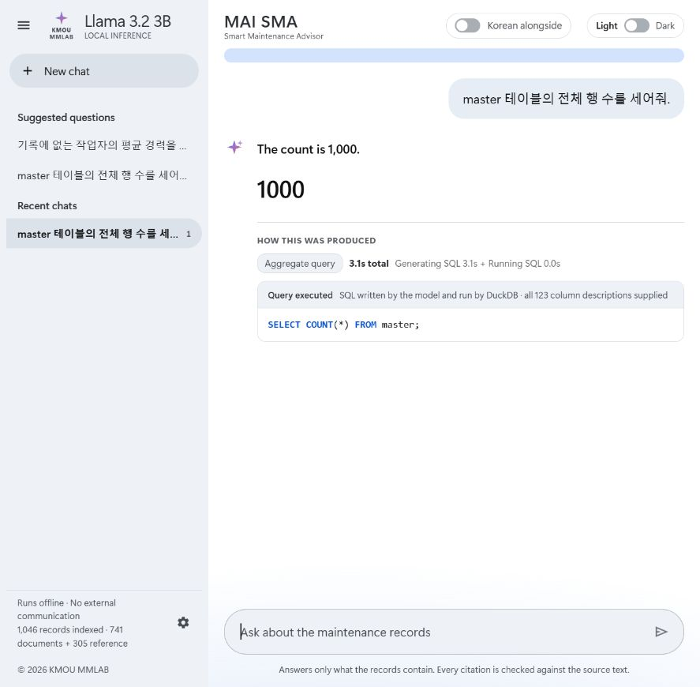

# Llama 3.2 3B 로컬 앱 실행 화면

2026년 11월 20일 실제 실행 화면입니다. 교수자가 제공한 학생용 1,000문서 DB를 사용했습니다.

## 논문용 그림 설명

**국문:** 사용자가 `master` 테이블을 지정한 집계 질문에 대해 Llama 3.2 3B가 SQL을 생성하고, DuckDB의 읽기 전용 조회 결과 1,000행을 표시하는 MAI SMA 로컬 앱 화면.

**English:** MAI SMA local application using Llama 3.2 3B to generate SQL for an explicitly named `master` table and display a count of 1,000 rows from a read-only DuckDB query.

## 화면에서 확인할 수 있는 내용

- 실제 모델 ID: `mai-sma-llama3.2-8k:3b` (Msty 로컬 API).
- 실제 입력: `master 테이블의 전체 행 수를 세어줘.`
- 모델이 생성한 SQL: `SELECT COUNT(*) FROM master;`
- 실제 반환값: `1000`. 별도의 읽기 전용 DB 조회로도 확인했습니다.
- 화면에 표시된 처리 시간: 총 3.1초. 한 번의 시연에 표시된 값이며 평균 응답 시간은 아닙니다.
- 사이드바의 검색 색인 1,046건은 서술 문서 기록 741건과 참고 기록 305건의 합입니다. `master` 테이블의 문서 1,000건과 서로 다른 수치입니다.

## 해석과 공개 범위

이 그림은 한 번의 UI 실행 사례이며 전체 성능을 나타내지 않습니다. 앞서 일반적인 '전체 정비 문서 수' 질문에는 모델이 `pms` 테이블을 세어 작업 라인 수 2,296을 반환한 오답도 확인했습니다. 논문용 주 그림의 질문은 집계 대상 테이블을 명시합니다.

기존 200문항 평가 결과는 [별도 평가 보고서](../../results/llama32_3b/3B_평가결과.md)를 확인하십시오. 집계형 엄격 정답 29/100, 절차형 JSON 유효 70/100, 생성 단계 인용 일치 482/844(57.1%)이며, 이번 시연으로 이 수치를 바꾸지 않았습니다.

원본 이미지는 실제 브라우저 캡처입니다. 결과값이나 모델명을 이미지 편집으로 바꾸지 않았습니다. 공개 화면에는 집계 결과와 일반 예시 질문만 표시하며 DB 파일, 정비기록 본문, 평가 응답 원자료는 포함하지 않습니다.

캡처 시 밝은 테마와 사이드바 폭을 조정하고, 제공 평가 질문 목록 대신 동봉한 일반 예시 질문 2개를 사용했습니다. HTML 화면의 모델 표시 이름을 `Llama 3.2 3B`로 정리했으며, 실제 API 모델 ID는 `mai-sma-llama3.2-8k:3b`를 유지합니다. 추론·SQL 실행·연구 프롬프트·라우터·채점기는 변경하지 않았습니다. 동일 예시 목록을 쓰려면 로컬 `config.json`의 `samples`를 `evidence/app/paper_capture_questions.txt`로 지정할 수 있습니다.

이 폴더의 기존 `APP-01` 이미지는 이전 300건 버전의 보관 자료입니다. 현재 1,000문서 학생판의 논문용 그림은 위 `PAPER-01` 파일입니다.
